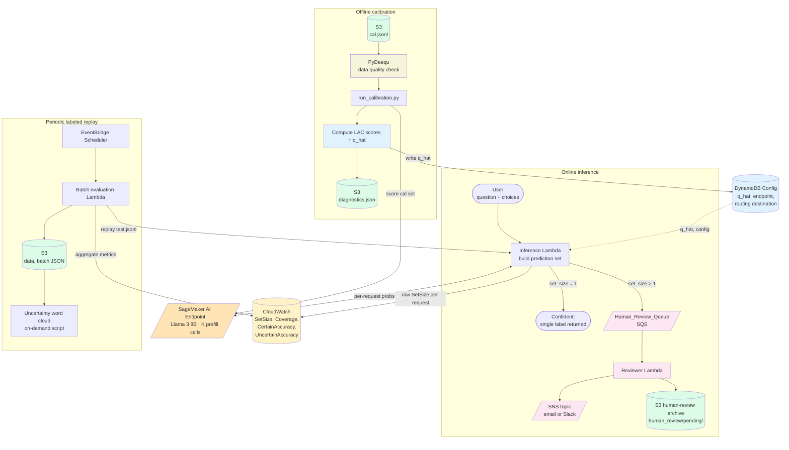

# Monitoring LLM Uncertainty in Financial Services on AWS

> **Important:** This is sample code for demonstration and educational purposes only, not intended for
> production use. You should work with your security and legal teams to meet your organizational security,
> regulatory, and compliance requirements before deployment.

Demonstrates how to monitor LLM predictive uncertainty in production using conformal prediction on AWS.
Includes calibration, real-time prediction set monitoring via Amazon CloudWatch, human-in-the-loop routing
for uncertain predictions, and batch evaluation. Built on Amazon SageMaker AI, AWS Lambda, Amazon DynamoDB,
Amazon CloudWatch, Amazon EventBridge, Amazon SNS, and Amazon SQS.

## What it does

Turns a single LLM prediction into a **calibrated prediction set** whose size quantifies per-question
uncertainty — enabling label-free monitoring and principled human-in-the-loop routing for production
LLM classification in financial services and other regulated domains.

Conformal prediction has strong theoretical foundations (Vovk et al., 2005; Papadopoulos et al., 2002;
Lei et al., 2013) and recent validation on LLMs (Ye et al., 2024). It is distribution-free, model-agnostic,
and easy to implement. For a target coverage `1 - α`, the prediction set contains the true label with
probability at least `1 - α` by construction — a finite-sample marginal coverage guarantee that softmax
thresholding cannot offer.

- **Set size = 1** → confident prediction, returned to the user.
- **Set size > 1** → uncertain prediction, routed to human review.

The set-size distribution is a label-free monitoring signal: when it drifts upward over time, model
uncertainty is increasing — a direct trigger to recalibrate or widen the human review scope.

### Why this matters for regulated industries

In financial services, ground-truth labels arrive weeks or months after prediction (compliance reviews,
credit outcomes, regulatory filings). Without labels, you can't compute standard accuracy metrics in
real time. Prediction set size provides a label-free drift signal available on every production request.

This system supports regulatory model risk management frameworks:
- **SR 11-7** (Federal Reserve): ongoing monitoring and detection of out-of-range operation
- **EU AI Act**: transparency about model limitations, accuracy measures, and human oversight
- **UK SS1/23** (PRA): model limitation identification and performance monitoring with human oversight

The regulatory references in this document are provided for informational purposes only and don't
constitute legal advice. Consult your legal and compliance teams to determine specific requirements
for your use case and jurisdiction.

## How calibration works

Split the labeled data into `calibration` and `test`. For every calibration sample, query the LLM endpoint K times —
once per candidate answer token — and read the prefill log-probability of the appended token; softmax over those K
log-probs gives a probability vector `p`. Compute the LAC nonconformity score `s = 1 - p[y_true]`. The threshold
`q_hat` is the quantile of calibration scores at the target coverage level, with a small upward correction that
accounts for the finite calibration set size. At inference time the prediction set is
`{k : p[k] ≥ 1 - q_hat}` — guaranteed to cover the true label with probability `≥ 1 - α` over the marginal
distribution of new test points.

This statistical guarantee requires only that calibration and inference data come from the same distribution —
meaning the types of inputs seen during calibration are representative of those encountered in production. This is
a weaker assumption than most statistical methods, making it practical for LLM monitoring where strong distributional
assumptions are hard to verify.

## Architecture

Three runtime phases — **calibrate offline, predict online, monitor continuously** — connected through a DynamoDB
`Config` table (`q_hat`, endpoint, routing destination), CloudWatch (metrics), and S3 (artifacts). A JumpStart
text-generation endpoint is the only stateful AWS resource that holds GPU; everything else is serverless.

Monitoring runs on two complementary layers:

- **Live, label-free** — the inference Lambda publishes `SetSize` per request to CloudWatch. The "mean prediction
  set size" panel is just `Statistic=Average, Period=1h` on that raw metric. No scheduler, no extra compute.
- **Periodic, labeled** — EventBridge fires a batch-evaluation Lambda periodically that replays the labeled holdout
  through the inference Lambda, emits aggregate metrics that need ground truth (`Coverage`, `Top1Correct`,
  `CertainAccuracy`, `UncertainAccuracy`, `AveragePredictionSetSize` as a stable named metric), and writes a
  `batch/{run_id}.json` (batch JSON) to S3 for the XAI step to consume on demand.

Key monitoring metrics:

| Metric | Source | Description |
|--------|--------|-------------|
| `SetSize` | Live (per request) | Raw prediction set size — label-free drift signal |
| `Coverage` | Batch (labeled) | Fraction of predictions where true label is in the set |
| `CertainAccuracy` | Batch (labeled) | Top-1 accuracy for predictions with set size = 1 |
| `UncertainAccuracy` | Batch (labeled) | Top-1 accuracy for predictions with set size > 1 |
| `AveragePredictionSetSize` | Batch (labeled) | Stable named metric for batch-level set size |
| `RoutedToHumanReview` | Batch (labeled) | Fraction of predictions routed to human review |

The accuracy gap between certain and uncertain predictions validates the routing decision: in our
demonstration, certain predictions achieve 91–94% accuracy while uncertain predictions drop to 41–60%,
confirming that routing uncertain predictions to human review is well-justified.



## Components

| Component | Service | Role |
|---|---|---|
| LLM endpoint | SageMaker JumpStart real-time endpoint | Returns prefill log-probs for the K answer tokens. |
| Calibration | **Real-time endpoint** (`run_calibration.py`) | Scores `cal.jsonl` against the endpoint (K prefill calls per row), computes LAC nonconformity scores and `q_hat`, writes `q_hat` to DynamoDB and `diagnostics.json` to S3. |
| Inference Lambda | AWS Lambda + `boto3` | Per request: builds the prediction set, emits raw `SetSize` and routing/latency metrics to CloudWatch, routes uncertain predictions to SQS. |
| Batch evaluation Lambda | AWS Lambda triggered by EventBridge | Periodically replays the labeled holdout through the inference Lambda, computes labeled aggregates (`Coverage`, `Top1Correct`, `AveragePredictionSetSize`, `CertainAccuracy`, `UncertainAccuracy`), writes batch JSON to S3. |
| Config + state | **DynamoDB** `LLMUncertaintyConfig` table | Single item (partition key `config_id="default"`) holds `q_hat`, `endpoint_name`, `target_coverage`, `cloudwatch_namespace`, `human_review_destination_arn`, etc. Cold-start-cached by the Lambdas. |
| Storage + dashboards | S3 + CloudWatch | Data splits, calibration diagnostics, batch JSON, all per-request and aggregated metrics. |
| Human review | SQS + Reviewer Lambda + SNS + S3 archive | Uncertain predictions queue up in SQS; a small Reviewer Lambda archives the full payload to `s3://.../human_review/pending/{run_id}-{message_id}.json` and notifies a reviewer via an SNS topic (email or Slack). A **Cognito-authenticated reviewer dashboard** and **Amazon Augmented AI (A2I)** are documented as production upgrades. |
| Data quality | **PyDeequ** (offline) | Declarative checks on `cal.jsonl` and `test.jsonl` (non-empty, complete required columns, `answer ∈ [0, K)`, unique `index`) gate the calibration step. |
| Uncertainty XAI | On-demand Python script | Consumes batch JSON from S3 to render word clouds: single uncertain-tail cloud, or side-by-side certain vs. uncertain comparison with top-N term lists. No scheduler. |


## Data shapes

Three artifacts move through the pipeline. Examples are illustrative; field types match production.

**MMLU sample** (one line of `cal.jsonl` / `test.jsonl` written by `prepare_data.py`):

```json
{
  "index": 42,
  "subject": "marketing",
  "question": "What is the primary purpose of market segmentation?",
  "choices": ["Reduce production cost", "Identify target customer groups",
              "Eliminate competition", "Increase advertising spend"],
  "answer": 1
}
```

**DynamoDB Config row** (single item in `LLMUncertaintyConfig`, partition key `config_id="default"`):

```json
{
  "config_id": "default",
  "endpoint_name": "meta-textgeneration-llama-3-8b-2026-05-22-15-00-00",
  "model_id": "meta-textgeneration-llama-3-8b",
  "num_choices": "4",
  "cloudwatch_namespace": "LLMUncertainty",
  "nonconformity_score": "LAC",
  "target_coverage": "0.9",
  "conformal_threshold": "0.42",
  "human_review_destination_arn": "arn:aws:sqs:eu-west-1:123456789012:Human_Review_Queue",
  "human_review_destination_type": "sqs"
}
```

**Batch JSON** (one file per replay, written by the batch evaluation Lambda to `s3://.../batch/{run_id}.json`):

```json
{
  "run_id": "2026-05-22T15:00:00Z",
  "endpoint_name": "...",
  "target_coverage": 0.9,
  "q_hat": 0.42,
  "aggregates": {
    "AveragePredictionSetSize": 1.34,
    "Coverage": 0.91,
    "Top1Correct": 0.78,
    "RoutedToHumanReview": 0.18,
    "CertainAccuracy": 0.92,
    "UncertainAccuracy": 0.54
  },
  "records": [
    {
      "index": 42,
      "question": "...",
      "probabilities": [0.05, 0.80, 0.10, 0.05],
      "prediction_set": [1],
      "set_size": 1,
      "is_certain": true,
      "top1_prediction": 1,
      "ground_truth": 1,
      "covered": 1,
      "top1_correct": 1
    }
  ]
}
```

`aggregates` powers CloudWatch dashboards; `records` feeds the XAI word cloud.

**Inference Lambda — request and response** (the wire format an integrator codes against):

```json
// request
{ "question": "What is the primary purpose of market segmentation?",
  "choices": ["Reduce production cost", "Identify target customer groups",
              "Eliminate competition", "Increase advertising spend"] }

// response — certain prediction
{ "statusCode": 200,
  "body": { "prediction_set": [1],
            "probabilities": [0.05, 0.80, 0.10, 0.05],
            "top1_prediction": 1, "set_size": 1, "is_certain": true,
            "conformal_threshold": 0.42, "routing_decision": "auto" } }

// response — uncertain prediction (also queued to SQS)
{ "statusCode": 200,
  "body": { "prediction_set": [0, 2],
            "probabilities": [0.42, 0.05, 0.40, 0.13],
            "top1_prediction": 0, "set_size": 2, "is_certain": false,
            "conformal_threshold": 0.42, "routing_decision": "human_review" } }

// response — routing failure (uncertain prediction could not be dispatched to SQS)
// The prediction body is NOT returned; callers must handle the error status.
// 503 = missing configuration (ARN or destination type not set)
// 502 = SQS dispatch failed after retry
{ "statusCode": 502,
  "body": { "error": "SQS dispatch failed",
            "routing_decision": "human_review",
            "human_review_destination_arn": "arn:aws:sqs:..." } }
```

**SQS message body** (uncertain prediction routed to a reviewer):

```json
{ "run_id": "2026-05-22T15:00:00Z",
  "question": "...", "choices": ["...", "..."],
  "probabilities": [0.42, 0.05, 0.40, 0.13],
  "prediction_set": [0, 2], "top1_prediction": 0,
  "conformal_threshold": 0.42,
  "routing_decision": "human_review",
  "endpoint_name": "..." }
```

> **A note on `ground_truth`.** The schema admits an optional integer `ground_truth` field on the request and
> propagates it through the response, the SQS body, and the batch JSON. It is **not** part of the production wire
> contract — production traffic does not carry labels. The field exists so the same Lambda can be replayed against
> labeled holdouts (`cal.jsonl` / `test.jsonl`) by `scripts/run_batch_evaluation.py`, which then computes `Covered`
> and `Top1Correct` for the periodic labeled-replay metrics. In a real deployment, labels arrive **after the fact**
> (reviewer adjudication, downstream system feedback, manual annotation) and are landed in S3 alongside the original
> request payload — when, and only when, they become available. The live monitoring path stays label-free; the
> labeled-replay path opportunistically uses whatever labels exist.

## Monitoring: mean prediction set size (label-free signal)

The end-to-end loop is **calibrate → infer → monitor**, and the headline operational metric is the **mean prediction
set size**.

Two layers expose it:

1. **Live, no scheduler.** The inference Lambda publishes raw `SetSize` per request to CloudWatch. A dashboard widget
   (or alarm) with `Statistic=Average, Period=1h` displays the rolling mean over any time bucket — `5m`, `1h`, `1d`.
   This is the path that runs on every production request and powers the real-time monitoring story.
2. **Periodic labeled replay.** EventBridge triggers the batch-evaluation Lambda; it replays the labeled holdout
   through the inference Lambda and publishes `AveragePredictionSetSize` as a *named* aggregate metric alongside
   `Coverage` and `Top1Correct` (which require ground truth and so cannot be derived from live traffic).

Why this matters:

- **Label-free.** `SetSize` is a function of the LLM output and `q_hat` only — no ground truth required at inference
  time. The live signal is available on every production request, not just labeled benchmarks.
- **Drift detector.** `q_hat` is fixed by the calibration step; the prediction set widens or narrows purely as a
  function of how the model responds to the live input distribution. A rising mean set size is direct evidence of
  distribution shift or emerging hard subpopulations.
- **Action trigger.** When the rolling mean crosses an alarm threshold, the on-call gets a CloudWatch alert. The
  fix is one of: re-calibrate against fresh labels (refresh `q_hat`), refresh the LLM, or temporarily lower the
  routing threshold so more borderline predictions go to humans.

## Human review routing

When the inference Lambda produces `set_size > 1`, the prediction is uncertain by the conformal definition. The
Lambda emits `RoutedToHumanReview = 1` to CloudWatch and sends the full payload (question, choices, probability
vector, prediction set) to an SQS queue.

A small **Reviewer Lambda** drains the queue (`MessageBatchSize = 1`) and, for each message:

1. **Archives the full payload to S3** at `s3://{HUMAN_REVIEW_BUCKET}/human_review/pending/{run_id}-{message_id}.json`. The archive happens *first* so any notification recipient can rely on the file existing.
2. **Publishes a one-paragraph summary to an SNS topic**, which fans out to email, Slack, or any other SNS-compatible channel.

Why both? SNS is the human-facing notification — fast, push-based — but messages aren't durable beyond the subscription. The S3 archive is the durable record: every uncertain payload, with its full probability vector and prediction set, lives there for audit and downstream retraining.

The reviewer destination is stored in DynamoDB (`human_review_destination_arn`), so the routing path can be re-pointed without a Lambda redeploy. Two production upgrades are documented in `docs/production-upgrades.md`:

- **Cognito-authenticated reviewer dashboard** — a small Amplify SPA where reviewers browse pending payloads, click the correct answer, and the result lands in a feedback table for retraining.
- **Amazon Augmented AI (A2I)** — replace the Reviewer Lambda + SNS with an A2I FlowDefinition. A2I provides a managed worker UI, task lifecycle, and workforce management; the inference Lambda's only change is one branch in `_route_to_human_review` that calls `start_human_loop` instead of `send_message`. Switchable via `human_review_destination_type`.

## Uncertainty explainability (XAI)

The `uncertainty_explainer` module is **on-demand** — no scheduler. It consumes the batch JSON written by the
periodic labeled replay (or any equivalent input) and provides two complementary views:

1. **Uncertain-tail word cloud** (`explain_uncertainty`) — filters to records with `set_size ≥ min_set_size`,
   renders a word cloud over the question text of those records. Frequent terms surface the topics, vocabulary,
   and entities the model struggles with.

2. **Certain vs. uncertain comparison** (`compare_certain_uncertain`) — splits records into certain
   (`set_size = 1`) and uncertain (`set_size ≥ 2`) groups, generates side-by-side word clouds (Blues colormap
   for certain, Reds for uncertain), and returns **differential term rankings**
   (`top_uncertain_differential`, `top_certain_differential`) that surface words disproportionately associated
   with one group over the other. This highlights *what differentiates* the questions the model handles
   confidently from those it doesn't.

The pipeline is fully serverless and offline:

```
S3 batch JSON  →  uncertainty_explainer  →  word cloud PNG (S3 + local)
```

This complements the quantitative monitoring signal: the dashboard tells you *that* uncertainty is rising; the
word cloud tells you *what* the model is uncertain about, and the comparison view shows *which topics* the model
handles well vs. poorly — directly informing whether to recalibrate, retrain, or route a specific subpopulation
to humans by default.

## Practical considerations

### Why LLMs over traditional classifiers?

Traditional text classifiers (keyword-based models, smaller pre-trained language models) could handle
straightforward text classification. However, LLMs offer critical advantages for enterprise deployment:

- **Zero/few-shot capability**: No labeled training data needed to start classifying — important when
  new categories emerge frequently (e.g., novel regulatory filing types, new financial instruments).
- **Larger context windows**: LLMs process full documents (contracts, complaint narratives, regulatory
  filings), not just truncated snippets.
- **RAG integration**: LLM responses can be customized with retrieval-augmented generation (RAG) to
  incorporate up-to-date policy documents or internal knowledge bases at inference time. Combined with
  fine-tuning and continued pre-training for domain adaptation, these complementary techniques enable
  tailoring to specific use cases.
- **Multimodal extension**: Because conformal prediction operates on the model's output probability
  distribution (not the input modality), this pipeline extends naturally to vision-language models
  classifying insurance claim photos, Know Your Customer (KYC) documents, or other multimodal inputs —
  monitored with identical CloudWatch metrics.

### Cost and latency

With K answer choices, conformal prediction requires K prefill-only forward passes per question (K=4 for
MMLU). No token generation is needed — only the log-probability of the appended answer token is read.

On an `ml.g5.2xlarge` endpoint with Llama 3 8B:
- **Latency**: ~250ms per question (4 sequential prefill calls)
- **Cost**: ~$1.50/hour for the endpoint (same as standard inference)
- **Overhead**: The conformal logic (set construction, metrics publishing) adds <1ms

The marginal cost is minimal compared to the value of knowing when your model is unreliable. In regulated
industries, a single undetected misclassification in compliance or credit risk assessment can result in
regulatory penalties and reputational damage that far exceed the inference overhead.

### Financial services applications

| Use Case | Certain → Auto-process | Uncertain → Human Review |
|----------|----------------------|--------------------------|
| Credit risk rating | Clear-cut ratings (AAA, default) | Borderline cases (BBB/BB boundary) |
| AML alert triage | Obvious true/false positives | Ambiguous transaction patterns |
| Insurance claims | Standard claims with clear documentation | Complex claims requiring expert judgment |
| Regulatory filing classification | Standard filings with clear category | Novel instruments or ambiguous filing types |
| Financial news sentiment | Clearly positive/negative articles | Mixed-signal or sarcastic content |

In each case, the prediction set acts as an automated quality gate: predictions the model is confident
about flow through instantly, while uncertain predictions are escalated with full context (question,
probability vector, prediction set) for human review.

## Adapt to your use case

To operationalize this pipeline for your own classification task:

1. **Swap the dataset.** Replace `data_loader.py` with a loader that produces rows with `question`,
   `choices`, and `answer` fields. The rest of the pipeline (calibration, inference, monitoring)
   consumes this schema unchanged.

2. **Choose your model.** Pass `--model-id` (and optionally `--model-version`) to `deploy_model.py`
   to point at any TGI-served JumpStart model. For non-TGI models (any API returning class
   probabilities), replace `get_answer_probs` in `probability_extractor.py` with your model's
   probability extraction logic.

3. **Tune coverage.** Set `target_coverage` (e.g., 0.95 for safety-critical tasks, 0.80 for
   cost-sensitive ones). Higher coverage produces larger prediction sets and routes more predictions
   to human review.

4. **Set up alerting.** Create a CloudWatch alarm on `SetSize` (Average, 1-hour period) with a
   threshold that triggers when uncertainty rises above your baseline:

   ```bash
   aws cloudwatch put-metric-alarm \
     --alarm-name "LLM-Uncertainty-Drift" \
     --namespace LLMUncertainty \
     --metric-name SetSize \
     --statistic Average \
     --period 3600 \
     --threshold 2.0 \
     --comparison-operator GreaterThanThreshold \
     --evaluation-periods 1 \
     --alarm-actions arn:aws:sns:<REGION>:<ACCOUNT>:ops-alerts
   ```

5. **Connect human review.** The pipeline routes uncertain predictions to SQS by default. Subscribe
   your review team via SNS (email/Slack), or integrate with Amazon A2I for a managed reviewer UI
   with task assignment and workforce management.

## Tested with

This POC has been validated end-to-end against:

- **Dataset**: [MMLU (Hendrycks et al., 2021)](https://github.com/hendrycks/test) (`cais/mmlu` on the HuggingFace Hub) — multiple-choice with `question`, `choices`, `answer`, `subject`. The `data_loader` schema is MMLU-specific; adapting to a different benchmark requires a new loader (the rest of the pipeline is dataset-agnostic).
- **LLM**: SageMaker JumpStart text-generation models served by **TGI (Text Generation Inference)** — Llama 2, Llama 3, Mistral, Falcon. The `probability_extractor` reads `details.prefill[*].logprob`, a TGI-only field. JumpStart models served by DJL/LMI containers, and Bedrock models, are **not** supported without a different `get_answer_probs` implementation.

**Switching models**: pass `--model-id` and `--model-version` to `deploy_model.py`. No code changes needed — the pipeline is model-agnostic as long as the endpoint serves TGI with prefill logprobs. Each model gets its own `q_hat` via recalibration.

**Extending to other LLMs**: for non-TGI models (Bedrock, DJL/LMI, or any API returning class probabilities), replace `get_answer_probs` in `probability_extractor.py` with the model's probability extraction logic. Everything else (conformal math, routing, monitoring, XAI) stays unchanged. The system applies to any LLM classification task where per-class probabilities can be obtained.

## Repository layout

```
llm_uncertainty_monitoring_system/
├── src/llm_uncertainty_monitoring/      # importable library
│   ├── conformal/                       # NonconformityScore, LACScore, compute_threshold
│   ├── calibration/                     # aggregation logic (compute_calibration, read_all_probs_lines)
│   ├── config/                          # dynamo_store helpers (load_config, put_config)
│   ├── data_loader.py                   # MMLU loading + difficult/cal/test split
│   ├── data_quality.py                  # PyDeequ checks (validate_mmlu_dataset)
│   ├── probability_extractor.py         # K prefill calls → softmax
│   ├── model_deployer.py                # ModelDeployer (deploy/attach/delete)
│   ├── metrics_publisher.py             # PredictionRecord + CloudWatch publisher
│   ├── inference_handler.py             # online inference Lambda handler
│   ├── reviewer_handler.py              # SQS-triggered reviewer Lambda handler
│   └── uncertainty_explainer.py         # word-cloud renderer (compare certain vs uncertain)
├── scripts/                             # CLI entry points (ML logic only, no resource creation)
│   ├── package_lambda.py                # build Lambda ZIP + upload to S3
│   ├── deploy_model.py                  # JumpStart deploy + DDB seeding
│   ├── prepare_data.py                  # offline data pipeline (MMLU load, split, S3 upload)
│   ├── validate_splits.py              # PyDeequ data-quality gate
│   ├── run_calibration.py               # real-time endpoint calibration (q_hat)
│   ├── run_batch_evaluation.py          # labeled-replay driver (also Lambda handler)
│   ├── explain_uncertainty.py           # differential word-cloud comparison CLI
│   └── smoke_end_to_end.py             # full-pipeline reproducibility check
├── tests/unit/                          # unit + property tests
├── examples/demo.ipynb                  # end-to-end SageMaker Studio walkthrough
├── template.yaml                        # CloudFormation stack (IAM, DynamoDB, S3, Lambda, SQS, SNS, EventBridge)
├── docs/                                # architecture.md, production-upgrades.md
├── blog/                                # blog/post.md (aws-samples publication)
├── requirements.txt                     # runtime (boto3, sagemaker, datasets, numpy, scipy, …)
├── requirements-dev.txt                 # +pytest, mypy, ruff, black, pydeequ, pyspark, …
├── requirements-lambda.txt              # minimal Lambda deps (numpy, scipy); boto3 excluded (in runtime)
├── pyproject.toml                       # build, ruff, black, mypy, pytest config
├── .pre-commit-config.yaml              # ruff, black, mypy, line-ending hooks
├── .github/workflows/ci.yml            # GitHub Actions CI (lint + test, Python 3.10–3.12)
├── LICENSE / NOTICE / SECURITY.md / CODE_OF_CONDUCT.md / CONTRIBUTING.md
└── CHANGELOG.md
```

The `src/` library never imports from `scripts/`. CLI scripts orchestrate AWS resources by calling library
modules — the library can be `import`-ed by Lambdas, notebooks, and tests with no AWS-side effects at import time.

## Status

Work in progress.

## Interactive demo

For a step-by-step walkthrough in SageMaker Studio, open [`examples/demo.ipynb`](examples/demo.ipynb).
The notebook covers model deployment, calibration, online inference with routing, 3-batch evaluation
(with CloudWatch alarm trigger), and uncertainty explanation — all in one place.

**Prerequisites**: complete steps 1–5 from the deployment instructions above before running the notebook.

## Infrastructure provisioning

All AWS resources (IAM roles, Lambda functions, SQS queues, SNS topics, S3 buckets, DynamoDB tables,
EventBridge schedule) are deployed via **CloudFormation** (`template.yaml`). The SageMaker endpoint
is deployed separately via `scripts/deploy_model.py` because JumpStart gated models require EULA
acceptance.

### Prerequisites

- **Python 3.10+** (tested with 3.10, 3.11, 3.12)
- **AWS account** with SageMaker Studio access
- **SageMaker quota**: `ml.g5.2xlarge` for endpoint usage > 0 (Service Quotas → SageMaker)
- **AWS CLI** installed and configured
- **Llama 3 EULA**: accepted via `--accept-eula` flag in the deploy step

### Deployment steps

> **Note**: Replace placeholders (`<ENDPOINT_NAME>`, `<run_id>`) with actual values from your
> deployment. The endpoint name is printed by `deploy_model.py`; batch run IDs are printed by
> `run_batch_evaluation.py` and listed in `s3://<DATA_BUCKET>/batch/`.

```bash
# 1. Set your variables. Replace 'amzn-s3-demo-<your-suffix>' below with a
#    globally-unique bucket name you own. Bucket names starting with
#    'amzn-s3-demo-' are reserved by AWS for documentation examples and
#    cannot be created; substitute a name specific to your organization
#    or project (e.g., 'myorg-uncertainty-deploy-...').
export ACCOUNT_ID=$(aws sts get-caller-identity --query Account --output text)
export REGION="${AWS_DEFAULT_REGION:-us-east-1}"
export DEPLOY_BUCKET="amzn-s3-demo-<your-suffix>-${ACCOUNT_ID}-${REGION}"
export LOG_BUCKET_NAME="amzn-s3-demo-<your-log-suffix>-${ACCOUNT_ID}-${REGION}"

# 2. Install dependencies
pip install -r requirements.txt && pip install -e .
# Optional (for data quality validation in step 7):
# pip install pydeequ pyspark

# 3. Create the deploy bucket (one-time, holds Lambda ZIP)
aws s3 mb "s3://${DEPLOY_BUCKET}" --region "${REGION}"

# 4. Package Lambda code and upload to S3
python scripts/package_lambda.py \
  --s3-bucket "${DEPLOY_BUCKET}" \
  --s3-key lambda-deployments/llm-uncertainty-lambda.zip

# 5. Deploy infrastructure (IAM, DynamoDB, S3, Lambda, SQS, SNS, EventBridge)
#    Required parameter: LambdaCodeS3Bucket (the deploy bucket from step 3)
#    Optional parameters: SubscriberEmail (for SNS notifications),
#      BatchScheduleExpression (default: "rate(24 hours)")
aws cloudformation deploy \
  --template-file template.yaml \
  --stack-name llm-uncertainty-monitoring \
  --parameter-overrides \
    LambdaCodeS3Bucket="${DEPLOY_BUCKET}" \
    LambdaCodeS3Key=lambda-deployments/llm-uncertainty-lambda.zip \
    LogBucketName="${LOG_BUCKET_NAME}" \
    SubscriberEmail="your-email@example.com" \
  --capabilities CAPABILITY_NAMED_IAM \
  --region "${REGION}"

# 6. Deploy the SageMaker endpoint (JumpStart, requires EULA acceptance)
python scripts/deploy_model.py --accept-eula --target-coverage 0.9

# 6b. Seed the human review routing config (connects inference to the SQS queue)
aws dynamodb update-item \
  --table-name LLMUncertaintyConfig \
  --key '{"config_id": {"S": "default"}}' \
  --update-expression "SET human_review_destination_arn = :arn, human_review_destination_type = :type" \
  --expression-attribute-values "{\":arn\": {\"S\": \"arn:aws:sqs:${REGION}:${ACCOUNT_ID}:LLMUncertainty-HumanReview\"}, \":type\": {\"S\": \"sqs\"}}" \
  --region "${REGION}"

# 6c. Read the CloudFormation-generated bucket names into shell variables.
#     The data and review buckets have BucketName omitted in the template
#     (CloudFormation auto-generates globally unique names). Retrieve them
#     from the stack outputs so the CLI examples below can use them.
export DATA_BUCKET=$(aws cloudformation describe-stacks \
  --stack-name llm-uncertainty-monitoring --region "${REGION}" \
  --query "Stacks[0].Outputs[?OutputKey=='DataBucketName'].OutputValue" \
  --output text)
export REVIEW_BUCKET=$(aws cloudformation describe-stacks \
  --stack-name llm-uncertainty-monitoring --region "${REGION}" \
  --query "Stacks[0].Outputs[?OutputKey=='HumanReviewBucketName'].OutputValue" \
  --output text)
export LOG_BUCKET=$(aws cloudformation describe-stacks \
  --stack-name llm-uncertainty-monitoring --region "${REGION}" \
  --query "Stacks[0].Outputs[?OutputKey=='LogBucketName'].OutputValue" \
  --output text)

# 7. Prepare data (load MMLU, extract probs, split, upload to S3).
#    prepare_data.py reads the data bucket from the DynamoDB config
#    (seeded by deploy_model.py from the stack outputs), so no
#    --s3-uri-prefix argument is needed.
python scripts/prepare_data.py --endpoint-name <ENDPOINT_NAME>

# 8. Validate splits (optional — data-quality gate, requires pydeequ + pyspark + Java 11)
#    Install: pip install pydeequ==1.4.0 pyspark==3.5.3
#    Java:    sudo apt-get install -y openjdk-11-jdk && export JAVA_HOME=/usr/lib/jvm/java-11-openjdk-amd64
#    Skip this step if data quality validation is not needed.
python scripts/validate_splits.py \
  --cal-s3-uri s3://${DATA_BUCKET}/data/cal.jsonl \
  --test-s3-uri s3://${DATA_BUCKET}/data/test.jsonl \
  --difficult-s3-uri s3://${DATA_BUCKET}/data/difficult.jsonl

# 9. Calibrate (score cal.jsonl via live endpoint, compute q_hat)
python scripts/run_calibration.py \
  --endpoint-name <ENDPOINT_NAME> \
  --cal-s3-uri s3://${DATA_BUCKET}/data/cal.jsonl \
  --output-s3-uri s3://${DATA_BUCKET}/calibration

# 10. System is now operational!
#     - Inference Lambda: responds to requests, routes uncertain predictions
#     - EventBridge: triggers periodic batch evaluation automatically
#     - CloudWatch: publishes SetSize per request + batch aggregates

# 11. Ad-hoc batch evaluation (3 batches with 5-min gaps, difficult in last batch)
#     This simulates distribution shift and triggers the CloudWatch alarm on batch 3.

# Batch 1 (normal — first third of test.jsonl)
python scripts/run_batch_evaluation.py \
  --input-s3-uri s3://${DATA_BUCKET}/data/test.jsonl \
  --s3-output-bucket ${DATA_BUCKET} \
  --s3-output-prefix batch \
  --max-rows 115

sleep 300  # Wait 5 minutes (CloudWatch alarm period)

# Batch 2 (normal — second third)
python scripts/run_batch_evaluation.py \
  --input-s3-uri s3://${DATA_BUCKET}/data/test.jsonl \
  --s3-output-bucket ${DATA_BUCKET} \
  --s3-output-prefix batch \
  --skip-rows 115 --max-rows 115

sleep 300  # Wait 5 minutes

# Batch 3 (remaining test rows + difficult questions)
python scripts/run_batch_evaluation.py \
  --input-s3-uri s3://${DATA_BUCKET}/data/test.jsonl \
  --difficult-s3-uri s3://${DATA_BUCKET}/data/difficult.jsonl \
  --s3-output-bucket ${DATA_BUCKET} \
  --s3-output-prefix batch \
  --skip-rows 230

# After batch 3: CloudWatch alarm should trigger (avg SetSize > 2.0)
# Check your email for the ALARM notification.

# 12. Generate uncertainty comparison word cloud (on-demand)
python scripts/explain_uncertainty.py \
  --batch-json-s3-uri s3://${DATA_BUCKET}/batch/<run_id>.json \
  --top-n 10 \
  --output-local-path ./wordcloud_comparison.png \
  --output-s3-uri s3://${DATA_BUCKET}/wordclouds/comparison.png
```

### Updating Lambda code

When you modify `src/` or `scripts/`, re-package and update the Lambda functions:

```bash
# Re-package and upload
python scripts/package_lambda.py \
  --s3-bucket "${DEPLOY_BUCKET}" \
  --s3-key lambda-deployments/llm-uncertainty-lambda.zip

# Update the stack (picks up the new ZIP). Pass the same LogBucketName value
# used on first deploy so CloudFormation reuses (not replaces) the log bucket.
aws cloudformation deploy \
  --template-file template.yaml \
  --stack-name llm-uncertainty-monitoring \
  --parameter-overrides \
    LambdaCodeS3Bucket="${DEPLOY_BUCKET}" \
    LambdaCodeS3Key=lambda-deployments/llm-uncertainty-lambda.zip \
    LogBucketName="${LOG_BUCKET_NAME}" \
  --capabilities CAPABILITY_NAMED_IAM
```

### CloudFormation stack resources

The `template.yaml` creates:

| Resource | Type | Purpose |
|----------|------|---------|
| IAM roles (3) | `AWS::IAM::Role` | Least-privilege roles for inference, reviewer, batch eval Lambdas |
| DynamoDB table | `AWS::DynamoDB::Table` | Pipeline config (q_hat, endpoint, routing destination) |
| S3 data bucket | `AWS::S3::Bucket` | Calibration/test data, batch results, diagnostics |
| S3 human-review bucket | `AWS::S3::Bucket` | Archived uncertain predictions |
| S3 log bucket | `AWS::S3::Bucket` | Server access logs for the data, review, and log buckets |
| KMS CMK (+ alias) | `AWS::KMS::Key` / `AWS::KMS::Alias` | Customer-managed key for DynamoDB config-table encryption |
| SQS queue | `AWS::SQS::Queue` | Human review queue for uncertain predictions |
| SNS topic | `AWS::SNS::Topic` | Reviewer notifications (email/Slack) |
| Lambda (inference) | `AWS::Lambda::Function` | Per-request prediction set construction + routing |
| Lambda (reviewer) | `AWS::Lambda::Function` | Archives to S3 + notifies via SNS |
| Lambda (batch eval) | `AWS::Lambda::Function` | Periodic labeled-replay evaluation |
| Event source mapping | `AWS::Lambda::EventSourceMapping` | SQS → Reviewer Lambda trigger |
| EventBridge schedule | `AWS::Scheduler::Schedule` | Periodic batch evaluation trigger |

### IAM roles (created by CloudFormation)

| Role | Trust | Permissions |
|------|-------|-------------|
| `LLMUncertainty-InferenceLambdaRole` | Lambda | SageMaker InvokeEndpoint, DynamoDB GetItem, SQS SendMessage, CloudWatch PutMetricData |
| `LLMUncertainty-ReviewerLambdaRole` | Lambda | S3 PutObject (review bucket), SNS Publish, SQS Receive/Delete |
| `LLMUncertainty-BatchEvalLambdaRole` | Lambda + Scheduler | Lambda Invoke, S3 Get/Put, DynamoDB GetItem, CloudWatch PutMetricData, SageMaker InvokeEndpoint |

### SageMaker Studio execution role permissions

If running the ML scripts from SageMaker Studio, attach a policy to the Studio execution role
that grants only the actions needed by this pipeline, scoped to the specific resources it creates
(prefix the resource ARNs with your account ID, region, and the bucket names above). Replace
`<ACCOUNT_ID>` and `<REGION>` accordingly.

| Action | Resource | Needed by |
|--------|----------|-----------|
| `cloudformation:CreateStack`, `UpdateStack`, `DescribeStacks`, `DescribeStackEvents`, `GetTemplateSummary`, `DeleteStack`, `CreateChangeSet`, `DescribeChangeSet`, `ExecuteChangeSet` | `arn:aws:cloudformation:<REGION>:<ACCOUNT_ID>:stack/llm-uncertainty-monitoring/*` | Deploying / updating / tearing down the stack |
| `iam:CreateRole`, `DeleteRole`, `GetRole`, `PassRole`, `AttachRolePolicy`, `DetachRolePolicy`, `PutRolePolicy`, `DeleteRolePolicy`, `GetRolePolicy` | `arn:aws:iam::<ACCOUNT_ID>:role/LLMUncertainty-*` | CloudFormation creates the three Lambda execution roles |
| `dynamodb:PutItem`, `GetItem`, `UpdateItem`, `DescribeTable` | `arn:aws:dynamodb:<REGION>:<ACCOUNT_ID>:table/LLMUncertaintyConfig` | `deploy_model.py` seeds the config; calibration and batch eval read it |
| `kms:Decrypt`, `GenerateDataKey`, `DescribeKey` | KMS key with alias `alias/LLMUncertainty-ConfigTable` (or the key ARN from stack outputs) | Reading/writing the DynamoDB config table (encrypted with a customer-managed CMK) |
| `s3:GetObject`, `PutObject`, `DeleteObject`, `ListBucket`, `GetBucketLocation` | The Lambda-deploy bucket you created in Step 1 and the CloudFormation-generated data, review, and log buckets (names discoverable via `aws cloudformation describe-stacks --stack-name llm-uncertainty-monitoring` — `DataBucketName` / `HumanReviewBucketName` / `LogBucketName` outputs) | Data upload/download, Lambda packaging, batch results |
| `s3:CreateBucket` | The Lambda-deploy bucket ARN | One-time creation of the deploy bucket |
| `lambda:CreateFunction`, `UpdateFunctionCode`, `UpdateFunctionConfiguration`, `GetFunction`, `DeleteFunction`, `CreateEventSourceMapping`, `DeleteEventSourceMapping` | `arn:aws:lambda:<REGION>:<ACCOUNT_ID>:function:LLMUncertainty-*` | CloudFormation creates and updates the three Lambda functions |
| `sqs:CreateQueue`, `DeleteQueue`, `GetQueueAttributes`, `SetQueueAttributes` | `arn:aws:sqs:<REGION>:<ACCOUNT_ID>:LLMUncertainty-HumanReview` | CloudFormation creates the review queue |
| `sns:CreateTopic`, `DeleteTopic`, `GetTopicAttributes`, `SetTopicAttributes`, `Subscribe`, `Unsubscribe` | `arn:aws:sns:<REGION>:<ACCOUNT_ID>:LLMUncertainty-ReviewerNotifications` | CloudFormation creates the notification topic |
| `scheduler:CreateSchedule`, `DeleteSchedule`, `GetSchedule`, `UpdateSchedule` | `arn:aws:scheduler:<REGION>:<ACCOUNT_ID>:schedule/default/LLMUncertainty-*` | CloudFormation creates the periodic batch-evaluation schedule |
| `sagemaker:CreateModel`, `CreateEndpointConfig`, `CreateEndpoint`, `DescribeEndpoint`, `InvokeEndpoint`, `DeleteEndpoint`, `DeleteEndpointConfig`, `DeleteModel` | `arn:aws:sagemaker:<REGION>:<ACCOUNT_ID>:endpoint/*`, `endpoint-config/*`, `model/*` | `deploy_model.py`, calibration, batch evaluation |
| `cloudwatch:PutMetricData` | `*` (CloudWatch requires wildcard resource; scope via `cloudwatch:namespace` condition = `LLMUncertainty`) | `run_batch_evaluation.py` publishes batch aggregates |
| `logs:CreateLogGroup`, `CreateLogStream`, `PutLogEvents` | `arn:aws:logs:<REGION>:<ACCOUNT_ID>:log-group:/aws/lambda/LLMUncertainty-*` | Lambda log streams |

### Cleanup

```bash
# 1. Delete the SageMaker endpoint (stop GPU costs immediately)
aws sagemaker delete-endpoint --endpoint-name <ENDPOINT_NAME> --region "${REGION}"

# 2. Empty S3 buckets (CloudFormation cannot delete non-empty buckets).
#    The data and review buckets have versioning enabled, so both current
#    objects AND all object versions/delete markers must be removed.
empty_versioned_bucket() {
  local bucket="$1"
  # Delete all object versions
  aws s3api list-object-versions --bucket "${bucket}" --output json \
    --query '{Objects: Versions[].{Key:Key, VersionId:VersionId}}' \
    | jq -c '.Objects[]?' \
    | while read -r obj; do
        key=$(echo "${obj}" | jq -r '.Key')
        vid=$(echo "${obj}" | jq -r '.VersionId')
        aws s3api delete-object --bucket "${bucket}" --key "${key}" --version-id "${vid}" >/dev/null
      done
  # Delete all delete markers
  aws s3api list-object-versions --bucket "${bucket}" --output json \
    --query '{Objects: DeleteMarkers[].{Key:Key, VersionId:VersionId}}' \
    | jq -c '.Objects[]?' \
    | while read -r obj; do
        key=$(echo "${obj}" | jq -r '.Key')
        vid=$(echo "${obj}" | jq -r '.VersionId')
        aws s3api delete-object --bucket "${bucket}" --key "${key}" --version-id "${vid}" >/dev/null
      done
}

empty_versioned_bucket "${DATA_BUCKET}"
empty_versioned_bucket "${REVIEW_BUCKET}"
empty_versioned_bucket "${LOG_BUCKET}"

# 3. Delete the CloudFormation stack (removes IAM, DynamoDB, Lambda, SQS, SNS, EventBridge, S3 buckets, alarm)
aws cloudformation delete-stack --stack-name llm-uncertainty-monitoring --region "${REGION}"
aws cloudformation wait stack-delete-complete --stack-name llm-uncertainty-monitoring --region "${REGION}"

# 4. Delete the deploy bucket (created manually, not part of the stack)
aws s3 rb "s3://${DEPLOY_BUCKET}" --force
```
