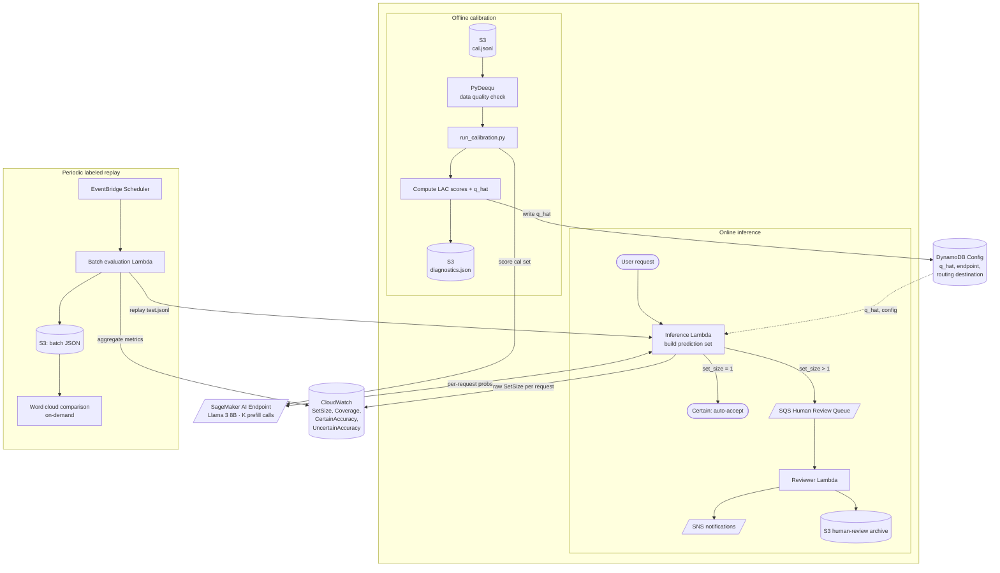

# Architecture

## Overview

The LLM Uncertainty Monitoring system operates in three phases:

1. **Offline calibration** — scores the calibration set against the live SageMaker endpoint, computes
   LAC nonconformity scores, derives q_hat, and writes it to DynamoDB. A PyDeequ data-quality gate
   validates the calibration data before scoring begins.
2. **Online prediction** — reads q_hat from DynamoDB and builds the prediction set for each request.
   Publishes the prediction set size metric to CloudWatch and routes uncertain predictions to SQS
   for human review.
3. **Periodic labeled replay** — EventBridge triggers periodic batch evaluation against labeled
   holdouts, publishing coverage, certain accuracy (accuracy of predictions with set size = 1),
   and uncertain accuracy (accuracy of predictions with set size > 1) to CloudWatch. Writes batch
   JSONs to S3 for uncertainty explanation.

### Monitoring metrics

| Metric | Source | Description |
|--------|--------|-------------|
| `SetSize` | Live (per request) | Raw prediction set size — label-free drift signal |
| `Coverage` | Batch (labeled) | Fraction of predictions where true label is in the set |
| `CertainAccuracy` | Batch (labeled) | Top-1 accuracy for certain predictions (set size = 1) |
| `UncertainAccuracy` | Batch (labeled) | Top-1 accuracy for uncertain predictions (set size > 1) |
| `AveragePredictionSetSize` | Batch (labeled) | Stable named metric for batch-level set size |
| `RoutedToHumanReview` | Batch (labeled) | Fraction of predictions routed to human review |

The accuracy gap between certain and uncertain predictions validates the routing decision and widens
under distribution shift — confirming that conformal routing becomes more valuable precisely when the
model is under pressure.

## Architecture Diagram



## Execution Contexts

| Context | Runs on | Triggered by | Frequency |
|---------|---------|--------------|-----------|
| **Calibration** | Studio notebook / terminal | Manual (after model deploy) | Once per model version |
| **Inference** | Lambda (or in-process) | User request / API call | Per request |
| **Review** | Lambda | SQS message | Per uncertain prediction |
| **Batch evaluation** | Lambda | EventBridge Scheduler | Configurable (daily default) |
| **XAI explainer** | Studio notebook / terminal | Manual (ad-hoc) | On demand |

## DynamoDB Config Table Layout

Table: `LLMUncertaintyConfig`
Partition key: `config_id` (String, default `"default"`)

| Attribute | Type | Written by | Read by |
|-----------|------|-----------|---------|
| `endpoint_name` | String | `deploy_model.py` | inference Lambda, batch eval |
| `model_id` | String | `deploy_model.py` | metrics publisher |
| `num_choices` | String | `deploy_model.py` | inference Lambda |
| `cloudwatch_namespace` | String | `deploy_model.py` | metrics publisher |
| `nonconformity_score` | String | `deploy_model.py` | informational |
| `target_coverage` | String | `deploy_model.py` | calibration script |
| `conformal_threshold` | String | `run_calibration.py` | inference Lambda |
| `calibration_set_size` | String | `run_calibration.py` | informational |
| `calibrated_at` | String | `run_calibration.py` | informational |
| `calibration_s3_uri` | String | `run_calibration.py` | informational |
| `human_review_destination_arn` | String | `deploy_inference_lambda.py` | inference Lambda |
| `human_review_destination_type` | String | `deploy_inference_lambda.py` | inference Lambda |
| `batch_period_seconds` | String | `schedule_batch_evaluation.py` | informational |

## Data Flow

```
prepare_data.py
  ├── Load MMLU (HuggingFace Hub)
  ├── Score all rows via endpoint → probs_by_index (cached locally)
  ├── Extract difficult (lowest max-prob per subject)
  ├── Split remaining → calibration + test
  └── Upload to S3: data/{cal,test,difficult}.jsonl

run_calibration.py
  ├── Download cal.jsonl from S3
  ├── Score each row via endpoint (K prefill calls)
  ├── Compute LAC scores + q_hat via compute_threshold()
  ├── Write q_hat to DynamoDB
  └── Upload diagnostics.json to S3

inference_handler.lambda_handler(event)
  ├── Read q_hat from DDB (cold-start cached)
  ├── Call endpoint (K prefill calls) → probability vector
  ├── Build prediction set: {k : p[k] >= 1 - q_hat}
  ├── Publish SetSize to CloudWatch
  └── If uncertain → send_message to SQS

run_batch_evaluation.py
  ├── Download test.jsonl + difficult.jsonl from S3
  ├── Invoke lambda_handler per row
  ├── Collect PredictionRecords
  ├── Publish batch aggregates to CloudWatch
  │   (Coverage, CertainAccuracy, UncertainAccuracy,
  │    AveragePredictionSetSize, RoutedToHumanReview)
  └── Write batch JSON to S3
```
